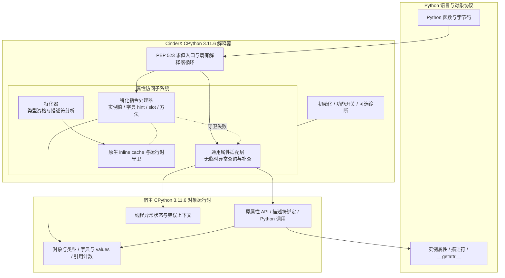

# 【性能】CPython 3.11.6 属性访问路径优化技术方案（RFC）

**状态 (Status):** Draft v0.7

**作者 (Authors):** @qq_16646553

**创建日期 (Created):** 2026-10-26

**更新日期 (Updated):** 2026-10-26

**相关 Issue/PR:** 待关联

---

# 1. 概述

本提案面向 CPython 3.11.6，在 CinderX 自定义解释器中优化**定义了 `__getattr__`、但仍使用默认 `__getattribute__`** 的对象的属性访问，包含两项配合使用的功能：

1. **普通查询缺失时，省去用于中转的临时 `AttributeError`，继续调用原 `__getattr__`。**
2. **普通属性或方法命中时，使用带守卫的特化路径，减少通用查询和不必要的绑定方法对象分配。**

方案依据 Python 对象协议和字典布局判断资格，不识别特定框架、类名或属性名称。通过 CinderX 扩展包交付，不修改系统 CPython 或应用源码，不依赖 JIT。

属性查找顺序、描述符行为、异常传播和动态变异的可见性必须与原协议一致。自定义 `__getattribute__`、不支持的对象形态及守卫失败的访问，正常回到原路径。

**首期不扩大支持范围。功能默认关闭；显式启用时完整开启；初始化失败明确报错，不静默退回或部分启用。本期验收实现正确性、基本功能及十模型运行验证，业务性能验收后续补充。**

交付包的安装、启用、状态检查和关闭方式见 **3.5**；业务代码仍使用原来的属性访问写法。

# 2. 用例分析

## 2.1 PyTorch 案例：正常属性读取中的临时异常

此前在 CPython 3.11.15 的 PyTorch eager 算子下发分析中，发现部分正常属性读取反复触发异常构造和内存分配。以 `module.weight` 为例，`weight` 通常保存在 `_parameters` 字典（参数注册表）中，而不是实例字典的同名字段中：

```python
# module.__dict__ 的相关内容，仅示意存储关系
{
    "training": False,                         # 普通字段
    "_parameters": {"weight": parameter_obj},  # 参数注册表
}
```

读取 `module.weight` 时，原路径为：

```text
普通属性查询未命中
    → 构造临时 AttributeError
    → 清除异常，调用原 Module.__getattr__
    → 从 _parameters 找到并返回 weight
```

**属性最终正常返回，但中间仍付出了异常构造和清除的成本。** 热点栈中出现的 `PyErr_Format`、`PyUnicode_FromFormatV` 和 `_PyObject_Malloc`，反映了错误消息格式化和临时对象分配的开销。频繁读取参数时，这些工作会重复发生，并非业务真的出错。

本方案在满足条件时省去中间异常，仍调用原来的 `Module.__getattr__`。对 `module.training` 这类普通字段命中，以及直接方法调用，则通过第二项优化减少通用查询成本。**不修改模型源码或 PyTorch 注册表，也不在解释器中识别特定框架。**

## 2.2 属性访问形态与处理方式

| 属性访问形态 | 当前成本或问题 | 设计处理 |
|---|---|---|
| 普通查询缺失，`__getattr__` 返回值 | 先构造缺失异常，再清除并补查 | 用无异常缺失状态连接查询与补查 |
| 带 `__getattr__` 的对象读取实例字段 | 因类型访问入口不同而拒绝特化 | 确认默认 getter 后，允许原有命中特化 |
| 实例字典物化为 split dict | 值位于实例 values 数组，按键表条目取值无法命中 | 按实际布局读取实例值 |
| 带 `__getattr__` 的对象直接调用方法 | 通用查找及可能的绑定方法对象构造 | 复用方法特化和 callable/self 调用协议 |
| 属性、类型或字典发生变化 | 原快路径依据可能失效 | 守卫失败后执行完整查询 |
| 实例字典含一般键表 | 键比较可能执行用户代码并产生副作用或异常 | 不能证明等价时，在查询前回退 |

## 2.3 代表性工作负载

选取以下10个模型，覆盖特征交互、多任务和序列推荐。模型实现沿用同一版本的RecSDK；需要固定的可调运行参数见附录A。

| 模型 | 类型 | Batch |
|---|---|---:|
| DLRM | 特征交互 | 128 |
| AutoInt | 注意力特征交互 | 128 |
| MMOE | 多任务 | 128 |
| ESMM | 多任务 | 128 |
| ETA | 行为序列 | 128 |
| DIEN | 兴趣演化 | 128 |
| SASRec | 序列推荐 | 128 |
| DCNv2 | 特征交叉 | 128 |
| HLLM | 分层LLM推荐 | 128 |
| GR 2B | HSTU序列推荐 | 1 |

GR 2B使用直接HSTU入口，不包含完整vLLM服务链路。

# 3. 方案设计

## 3.1 总体方案

### 3.1.1 设计基线与职责边界

方案以 **CPython 3.11.6** 的字节码、对象协议、类型版本和字典布局为基线，依托 CinderX 已有的 PEP 523 接入及对应版本的解释器循环。

改动限于解释器内的属性访问适配、属性/方法特化器和相关指令处理器。对象、类型、引用计数、异常状态和字典仍由宿主管理；不创建第二套对象系统，不修改用户类型的 `tp_getattro`，不缓存 `__getattr__` 的返回值。

首期只承诺支持**在交付清单中明确列出，并通过本方案验收的环境组合**。清单至少记录：

| 项目 | 约定 |
|---|---|
| Python 版本 | CPython 3.11.6；不将其他 3.11 补丁版本自动视为兼容 |
| 源码与构建身份 | CPython 快照、CinderX 提交、补丁集及构建产物标识 |
| 平台与构建形态 | 操作系统、架构、ABI、release/debug 等实际验收组合 |
| 解释器与执行状态 | 主/子解释器、trace/profile 等能力的支持状态，遵循既有 evaluator 边界 |
| 其他求值器 | 不覆盖未知的第三方 evaluator；未经验证的组合不纳入首期支持 |

本文不将待验证组合写为已支持。新增平台、Python 版本或执行组合，需单独验证，不作为本期范围的默认扩展。

### 3.1.2 总体架构



通用适配层保留完整对象协议，优化普通查询到补查的连接；特化器识别可直接命中的访问；指令处理器核对缓存证据，读取当前值。证据失效时回到通用路径，通用适配也不适用时调用原 API。

**优化一减少未命中的中间成本，优化二减少命中时的查询成本。**

### 3.1.3 接入与覆盖范围

在 CinderX 解释器编译单元内，为 `PyObject_GetAttr` 和 `_PyObject_GetMethod` 的相关调用提供内部适配入口。映射不替换宿主全局符号；回退必须调用原 API，避免递归进入适配层。

覆盖由该解释器执行的 `LOAD_ATTR`、`LOAD_METHOD` 及其特化形态。内建 `getattr()`、`hasattr()` 和 C 扩展直接调用宿主属性 API 的入口保持原实现，不因安装扩展而自动改写。

具体访问能否优化，由执行入口和对象形态共同决定；不承诺覆盖进程内所有属性访问。

## 3.2 技术选型

| 设计点 | 选择 | 理由 |
|---|---|---|
| 实施位置 | CinderX 的 3.11.6 解释器及特化器 | 复用解释语义，不修改系统 Python 和应用源码 |
| 未命中处理 | 在已证明等价的形态上使用异常抑制接口 | 避免冗余异常，不重写整套对象协议 |
| 命中加速 | 扩大已有特化的读取资格 | 保持 opcode、缓存尺寸和调用栈协议不变 |
| 字典读取 | 按 split/combined 布局分别取值 | 名称索引与实例值的存储位置对应 |
| 失效管理 | 复用类型版本和原有字典守卫 | 动态变异后恢复完整查询，不增加业务缓存 |
| 不支持形态 | 拒绝特化或运行时回退 | 保持描述符、键比较及用户 hook 的可观察行为 |

## 3.3 功能与性能设计

### 3.3.1 共同的对象资格判定

#### 3.3.1.1 适用的类型

对象的类型必须**保留默认的 `__getattribute__`，并提供 `__getattr__` 用于缺失后的补查**。这两个方法可以来自继承。具体检查如下：

1. 实际 `tp_getattro` 为认可的原生 `slot_tp_getattr_hook`。
2. 经类型及其 MRO 查找，`__getattribute__` 仍是 `object.__getattribute__`。
3. 经类型及其 MRO 查找，能够找到 `__getattr__`。

不能只检查类是否定义了 `__getattr__`，也不能只检查 slot 指针。自定义 `__getattribute__` 可改变命中时的行为，必须沿用原协议。

资格检查使用 `_PyType_Lookup` 等不执行描述符的内部查询。默认 getter 引用来自内建 `object` 类型，原生 hook 指针在初始化时获取。热路径和特化过程不创建探针类型、不主动执行用户回调，也不扫描实例全部属性。

本方案不开放自定义 C getter 登记。其他 getter 的支持需另行定义语义和生命周期契约。

#### 3.3.1.2 类型资格与实例存储检查

类型合格不代表所有实例存储形态都可优化。**一般键表的保守规则同时适用于优化一的通用适配和优化二的特化，不能只在特化器中检查。**

| 路径 | 检查时机 | 必须核对的内容 |
|---|---|---|
| 普通查询与补查 | 每次进入通用适配时 | 名称、slot、当前类型定义，以及普通查询的语义等价条件；不跨访问缓存 handler |
| 属性/方法特化 | 自适应指令尝试特化时 | 类型资格、描述符分类、实例存储形态和原生缓存证据 |
| 已特化的读取 | 每次执行特化指令时 | 类型版本及对应字典、布局、名称和空值守卫；不重复完整资格分析 |

属性名不是精确 Unicode 对象时，通用适配层直接回到原 API，由其完成类型检查和错误处理。

实例字典使用一般键表，或其他形态无法证明与原 slot 的查询、异常行为等价时，必须在执行可能产生副作用的普通查询前回退。判断只读取允许的内部标志，不扫描键，也不通过用户属性访问来探测布局。

等价性检查还应覆盖查询期间的变化，例如描述符替换实例字典。查询前的布局快照不能证明后续始终安全；无法证明等价的访问走原 API，不在查询后重试。具体用例见 3.6。

### 3.3.2 优化一：消除普通未命中的临时异常

本优化同时改变**普通查询如何报告缺失**和**上层如何判断需要补查**：将“返回NULL并设置AttributeError，再识别和清除异常”改为“内部查询返回NULL且没有异常，直接补查”。这两处必须一起修改，原 `__getattr__` 的逻辑保持不变。

#### 3.3.2.1 原路径为什么产生临时异常

`PyObject_GenericGetAttr` 是普通属性查询接口，其约定是找到属性就返回值，找不到就报告异常。它不负责判断外层是否还会补查。CPython 3.11.6中的实现调用：

```c
return _PyObject_GenericGetAttrWithDict(obj, name, NULL, 0);
```

最后一个参数为 `suppress=0`，要求普通缺失设置异常。外层 `slot_tp_getattr_hook` 再根据异常决定是否调用 `__getattr__`。仅保留默认getter分支时，核心逻辑为：

```c
res = PyObject_GenericGetAttr(obj, name);
if (res == NULL && PyErr_ExceptionMatches(PyExc_AttributeError)) {
    PyErr_Clear();
    res = call_attribute(obj, handler, name);
}
```

第一行执行普通查询；条件判断确认是属性缺失；清除异常后，最后一行绑定并调用补查函数。若补查成功，中间异常只承担“普通查询没找到”的通知作用，却已经付出了消息格式化、异常上下文处理及对象创建释放的成本。

**语言语义并不要求补查前一定创建异常；这是原接口组合传递缺失状态的方式。**

#### 3.3.2.2 改动一：使用无异常缺失接口

仅在通过3.3.1的类型和实例存储检查后，适配层改为直接调用内部接口：

```c
res = _PyObject_GenericGetAttrWithDict(obj, name, NULL, 1);
```

普通查找仍按原顺序执行。差别发生在查找结束、确实没有找到属性时：

```c
if (!suppress) {
    PyErr_Format(PyExc_AttributeError,
                 "'%.50s' object has no attribute '%U'",
                 tp->tp_name, name);
    set_attribute_error_context(obj, name);
}
```

`suppress=1`使这段默认缺失异常的构造被跳过，直接返回“NULL且没有异常”。对于普通缺失，省去的是异常的产生过程，而非产生之后再忽略。

描述符自身抛出的 `AttributeError` 可能已经创建异常对象，其处理仍须符合原slot语义；不能宣称这类异常也全部免于构造。其他错误必须保留并传播。

#### 3.3.2.3 改动二：同步修改补查判断

查询不再产生默认缺失异常后，原来的 `PyErr_ExceptionMatches(AttributeError)` 条件不会成立。因此调用者必须同步改为：

```c
if (res == NULL && !PyErr_Occurred()) {
    /* 按原规则绑定并调用 __getattr__。 */
}
```

完整分流如下：

| 查询结果 | 处理 |
|---|---|
| `res != NULL` | 普通查询成功，返回查得的值 |
| `res == NULL && !PyErr_Occurred()` | 没有结果且没有待传播异常，调用补查 |
| `res == NULL && PyErr_Occurred()` | 查询仍有错误，直接传播，不调用补查 |

普通缺失路径没有中间异常，因此无需再执行外层 `PyErr_Clear()`。但不能只修改`suppress`而保留旧判断，也不能对所有NULL结果都调用补查。一次查询完成后不重查；例如property抛 `ValueError`，应只执行一次并直接传播错误。

#### 3.3.2.4 保留补查调用、引用管理和最终异常

以下伪代码展示整体顺序，helper的失败处理和绑定细节仍须遵循原API契约：

```c
if (!eligible_type_and_storage(obj, name)) {
    return original_getattr(obj, name);
}

handler = lookup_getattr(Py_TYPE(obj));
/* 确认handler有效后，在可能执行描述符之前持有强引用。 */
Py_INCREF(handler);

res = _PyObject_GenericGetAttrWithDict(obj, name, NULL, 1);
if (res == NULL && !PyErr_Occurred()) {
    res = bind_and_call_getattr(handler, obj, name);
}

Py_DECREF(handler);
if (res == NULL) {
    preserve_attribute_error_context(obj, name);
}
return res;
```

- **查询前持有handler：** 描述符可能删除或替换类型上的 `__getattr__`，本次访问仍须使用原slot规定的handler快照，避免悬垂引用或行为改变。
- **按原规则绑定：** 沿用3.11.6 `call_attribute` 的语义，有 `tp_descr_get` 时先绑定，没有时直接调用；不假设handler必然是普通Python函数。
- **正确释放引用：** handler、临时绑定对象和结果分别管理，成功和失败分支都释放自身持有的引用。
- **保留最终异常：** 补查失败时，异常类型、消息、异常链及必要的 `AttributeError.name/obj` 保持原规则，不无条件覆盖已有信息。补查结果不复制、不持久缓存。

#### 3.3.2.5 守卫与解释器入口接入

上述改动位于CinderX解释器内部的属性适配入口，不将宿主 `PyObject_GenericGetAttr` 全局改为`suppress=1`。不满足3.3.1资格的对象调用原API；尤其不能将异常抑制接口无条件用于一般键表或其他未证明等价的存储形态。

`_PyObject_GetMethod` 同时返回属性值和调用协议标记。进入本通用补查路径时，结果是完整解析后的属性值，沿用原API的非未绑定方法标记，不额外注入self。结果可能是绑定方法、普通函数或其他可调用对象，不能仅因其可调用就按方法描述符处理。

### 3.3.3 优化二：普通属性与方法命中特化

#### 3.3.3.1 特化器放行规则

CPython 3.11.6 的 `analyze_descriptor()` 在读取分析中，会对 `tp_getattro != PyObject_GenericGetAttr` 的相关类型返回 `GETSET_OVERRIDDEN`，使仅增加补查能力的类型也被拒绝。

本次只放宽**读取分支**的资格判断：

```c
/* 仅示意读取分支；写入分支及其 tp_setattro 检查保持原样。
 * is_supported_attr_type() 表示 3.3.1.1 中的三项类型检查。 */
if (!store &&
    type->tp_getattro != PyObject_GenericGetAttr &&
    !is_supported_attr_type(type)) {
    return GETSET_OVERRIDDEN;
}
```

`analyze_descriptor()` 是共享 helper。必须检查所有调用点，保持 `STORE_ATTR`、写入描述符分类和 `tp_setattro` 规则不变，不能用上述片段替换整个函数。

类型放行后继续原有描述符分类，不因实例 dict 中存在同名值就直接读取。数据描述符仍优先于实例属性。property、任意 getset、自定义 getter 及原分析不支持的形态，继续拒绝相应直接读取特化；原实现明确支持的特殊成员按原规则处理。

沿用现有指令，不新增属性 opcode 或缓存字段。下表列出关键证据，不替代原指令的全部检查：

| 特化形式 | 必须保留的关键守卫和读取规则 |
|---|---|
| `LOAD_ATTR_INSTANCE_VALUE` | 类型版本、适用的实例 values 布局、原索引条件及当前值非空 |
| `LOAD_ATTR_WITH_HINT` | 类型版本、当前字典形态、hint 范围、键身份及当前值非空；按布局取值 |
| `LOAD_ATTR_SLOT` | 类型版本、允许的成员类型、原审计限制及槽位非空；按原偏移取值 |
| `LOAD_METHOD_WITH_VALUES` | 类型版本、实例 values 形态、共享键表版本及未被实例遮蔽的原有证据 |
| `LOAD_METHOD_WITH_DICT` | 类型版本、当前字典与键表版本、原方法缓存及未被实例遮蔽的原有证据 |
| `LOAD_METHOD_NO_DICT` | 类型版本、无实例 dict 的原有条件及方法缓存 |

方法路径不能只保留类型版本检查，而丢掉实例存储和键表版本证据。

#### 3.3.3.2 split dict 与 combined dict

物化 `obj.__dict__` 后，键和值仍可能分开存储：

| 布局 | 键的位置 | 值的位置 |
|---|---|---|
| Combined dict | `ma_keys` 条目 | 同一条目的 `me_value` |
| Split dict | 共享的 `ma_keys` 条目 | 该实例的 `ma_values->values[index]` |

split 布局中的键表条目不提供该实例的属性值。`LOAD_ATTR_WITH_HINT` 若始终读取条目的 `me_value`，会读到 NULL 并退出快路径。

保留类型版本、字典存在性、索引边界、键身份和空值检查，仅在取值处按布局分流：

```c
/* 关键取值逻辑；类型守卫、owner/dict 获取和栈处理沿用原实现。 */
DEOPT_IF(!PyDict_CheckExact(dict), LOAD_ATTR);
DEOPT_IF(!DK_IS_UNICODE(dict->ma_keys), LOAD_ATTR);
DEOPT_IF(hint >= dict->ma_keys->dk_nentries, LOAD_ATTR);

entry = DK_UNICODE_ENTRIES(dict->ma_keys) + hint;
DEOPT_IF(entry->me_key != name, LOAD_ATTR);

value = dict->ma_values != NULL
    ? dict->ma_values->values[hint]
    : entry->me_value;
DEOPT_IF(value == NULL, LOAD_ATTR);
```

读取的必须是当前实例的当前值。不同实例可以共享键表，不能共享属性值缓存；已有字段赋值后应立即可见。

引用管理顺序沿用原指令：先持有结果，再替换栈顶并释放 owner。引用释放可能触发析构和重入，不能据此假设整条指令绝不执行 Python 代码。

#### 3.3.3.3 一般键表的保守处理

实例 dict 可能包含非字符串键、字符串子类键或其他复杂键。通用查询可能调用 `__eq__` 并产生副作用或异常，直接按 hint 取值可能跳过这些行为。

按以下规则处理：

1. **通用适配层也要执行 3.3.1 的安全性检查。** 不能只在特化器中拒绝一般键表。
2. 需要直接查询实例 dict 的相关特化，仅接受适用的精确 dict 和 Unicode 键表。
3. `LOAD_ATTR_WITH_HINT` 执行时重查键表类别；方法路径保留原字典、键表版本和遮蔽检查。
4. 形态不符时走原属性协议；已经执行过有副作用的查询后，不得为了回退再查一次。

形态检查通过内部标志完成，不逐项扫描键。可能失败的 helper 必须按返回契约处理，不能带着未处理的异常返回“普通特化失败”。

#### 3.3.3.4 方法读取与直接调用

`obj.method(...)` 可由 `LOAD_METHOD` 及其特化形式产生 callable 和 self，再由原 3.11.6 调用协议执行。守卫满足时，可以省去通用查询和中间绑定方法对象。

`f = obj.method` 则属于 `LOAD_ATTR` 语义，必须返回可保存的属性对象。不能为了省分配，将它替换为两个内部栈槽。

### 3.3.4 动态失效与回退契约

只有当前证据足以证明与完整查询等价时，才走快路径。

| 动态变化 | 快路径处理 | 回退后的行为 |
|---|---|---|
| 修改已有实例值 | 从当前槽位或 values 取值 | 不缓存旧结果 |
| 删除实例属性、清空 slot | 空值、键或其他原守卫失败时退出 | 按原规则查找、补查或抛错 |
| 新增数据描述符 | 类型版本失效 | 恢复描述符优先级 |
| 替换 `__getattr__` / `__getattribute__` | 类型版本失效；通用入口重查资格 | 使用修改后的协议 |
| 修改 `__bases__` | 复用类型及派生类型失效规则 | 使用当前 MRO |
| 修改 `obj.__class__` | 当前类型不满足旧证据 | 按新类型查询 |
| 替换实例 dict 或改变键表 | 当前布局、名称、索引或版本证据不符 | 执行完整字典查询 |
| 实例字段遮蔽方法 | 原方法守卫失效 | 返回或调用实例上的同名值 |

类型版本为 0、缓存条件不成立或版本资源不可用时，沿用原有拒绝特化和回退规则，不截断版本号或复用过期证据。

守卫失败不一定立即重写 opcode；遵循 3.11.6 自适应机制的失败计数、通用执行和重新特化规则。

**运行时不适用属于正常情况。** 回退后继续执行原属性协议，不因一次未命中守卫而报启用失败，也不全局停用功能。初始化失败的处理见 3.3.6。

### 3.3.5 性能设计

本节说明拟减少的成本和实现约束，**不设置本期量化性能验收指标**。

#### 3.3.5.1 成本消减构成

| 路径 | 主要消减项 | 保留的成本 |
|---|---|---|
| 普通缺失后补查成功 | 临时缺失异常的构造、格式化、清除及对象周转 | 资格检查、普通查询、handler 绑定与调用 |
| 实例字段命中特化 | 重复通用查找和 hook 调度 | 类型/布局守卫、当前值读取、引用处理 |
| 物化 split dict | 读错位置引发的反复快路径退出 | 名称/索引检查、实例 values 读取 |
| 直接方法调用命中特化 | 通用查询及可省略的绑定对象分配 | 方法守卫和原调用协议 |

```text
未命中原路径 = 普通查询 + 临时异常构造与清除 + 补查调用
未命中优化后 = 资格检查 + 可抑制缺失的普通查询 + 补查调用

普通命中原路径 = hook 入口 + 通用查询 + 绑定或引用处理
命中特化后     = 版本与布局守卫 + 定位读取 + 必要的调用/引用处理
```

两项功能作用于不同访问集合。不能将单次未命中收益套到全部属性访问，也不能将局部成本消减等同于程序总耗时下降。

#### 3.3.5.2 热路径开销约束

- 资格检查、缓存检查和定位读取不主动调用用户 Python 代码；引用释放及调用协议保持原规则，并考虑重入。
- 不扫描实例字段，不在热路径新建类型或字典，不为 split dict 复制 values。
- 不建立按用户类型增长的额外全局缓存，不跨访问持有用户属性值或 handler。
- 使用原 inline cache，保持 code object 的缓存数量和布局不变。
- 原规则已支持的普通类型，不重复执行 3.3.1.1 的附加类型检查。
- 不支持或高多态访问沿用自适应退避；诊断统计默认关闭，不逐次打印日志或格式化对象。

#### 3.3.5.3 两项功能的协同

普通命中且缓存稳定时，由优化二直接返回；尚未特化或守卫失败时进入通用路径。符合优化一资格时执行三态查询，状态要求补查时才调用 `__getattr__`；否则使用原 API。

两项功能都不省略用户自己的补查计算，不缓存补查结果，不改变属性值存储位置。

### 3.3.6 初始化、配置与生命周期

**对外使用 `ATTR_PATH_MODE` 作为启动开关，默认值为 `off`。** 设置为 `cinderx` 时，完整开启两项优化及其依赖的 split/combined 读取支持，并保持 JIT 关闭。业务用户不需要组合内部开关；具体用法和接口来源见 3.5。

初始化在安装或切换 evaluator 前完成：读取配置、检查支持环境与入口所有权、获取默认 getter 和原生 hook、确认内部接口可用。探针类型只允许在此阶段创建并释放。

| 场景 | 行为 |
|---|---|
| 未显式启用 | 本功能不改变已有求值入口和属性处理路径；安装 wheel 本身不自动启用 |
| 显式启用且检查通过 | 按既有所有权协议完整启用，并提供可查询的实际状态 |
| 显式启用但初始化失败 | 明确报告原因，使本次启用失败；不静默退回，不将部分功能标为已启用 |
| 运行时对象或守卫不适用 | 正常回到原属性协议，继续业务执行 |
| 内部诊断关闭某一优化 | 只改变优化选择，不得关闭正确性守卫；不适用的布局使用安全原路径 |

所有初始化检查通过前，不发布已启用状态，不替换原求值入口。失败时清理本次持有的资源，保持原入口不变；业务启动器必须将显式启用失败作为失败处理，不能吞掉错误继续报告成功。

不覆盖未知第三方 evaluator。若 CinderX 已因其他功能安装，关闭本属性优化只表示恢复其原属性处理路径，**不等于卸载整个 evaluator**。

功能配置在初始化时确定，模式切换使用新进程。不新增运行中热卸载、热切换或跨 evaluator 接力。内部细分开关仅供诊断；关闭 split 读取支持时，不能让 split dict 继续进入不适用的取值分支。

### 3.3.7 代码组织与改动范围

| 模块 | 职责 |
|---|---|
| `cinderx/Interpreter/3.11/` 属性适配层 | 资格检查、三态查询、handler 绑定、异常上下文和引用清理 |
| `specialize_wrapper.c` 及资格 helper | 类型条件检查、初始化依赖、原生 hook 识别 |
| `specialize.c` 对应补丁 | 只放宽读取资格，拒绝不安全键表，保留原描述符分类和写入行为 |
| `ceval.c` 对应补丁 | WITH_HINT 布局分流及执行期守卫 |
| `ceval_wrapper.c` | 解释器局部属性 API 映射与循环接入 |
| 初始化与配置模块 | 开关、支持检查、失败处理及 evaluator 所有权 |

CPython 3.11.6 原始快照保持不变。改动以独立补丁管理，在构建目录生成副本并核对输入/输出一致性，再编译到扩展中。其他 Python 版本通过版本目录和编译边界隔离。

本功能不引入新的帧表示、调用协议、全局变量缓存或 JIT 代码生成逻辑。

## 3.4 安全隐私与 DFX 设计

| 维度 | 设计要求 |
|---|---|
| 正确性 | 返回值、异常状态和引用所有权一致；不支持形态使用原协议 |
| 兼容性 | 只承诺已列出且验证的环境；保留原 trace/profile 分派规则 |
| 可靠性 | 显式启用失败明确报错，无部分启用；运行时不适用正常回退 |
| 可维护性 | 两项功能独立组织，复用原分类、缓存与失效机制，检查共享 helper 的全部影响范围 |
| 可诊断性 | 状态可查询；可选记录补查、错误传播、守卫失败及特化状态，不默认采集属性值 |
| 可配置性 | 对外一个默认关闭的入口，启用时完整开启；细分开关仅用于内部诊断 |

“返回 NULL 且无异常”不必然是纯字典未命中，也可能来自按规则抑制的描述符 `AttributeError`；计数名称和解释必须保留这一区别。诊断接口与正常性能路径分离，不要求业务方理解内部计数。

## 3.5 安装、启用与状态检查

通过匹配CPython 3.11.6的wheel交付，不修改应用源码。功能默认关闭；显式启用时完整开启两项优化及所需字典读取支持，JIT保持关闭。交付包提供以下接口：

```bash
PY=/path/to/cpython-3.11.6/bin/python3.11
WHEEL=/path/to/cinderx.whl  # 替换为实际交付文件

# 安装：使用同一Python环境，依赖预先准备。
ATTR_PATH_MODE=off "$PY" -m pip install --no-index --no-deps "$WHEEL"

# 启用或关闭：分别启动新进程。
ATTR_PATH_MODE=cinderx "$PY" app.py
ATTR_PATH_MODE=off "$PY" app.py

# 状态检查。
ATTR_PATH_MODE=cinderx "$PY" -c 'import _cinderx_auto; print(_cinderx_auto._verify())'
```

`_verify()`应确认预期evaluator、两项优化和split读取支持已开启，JIT配置关闭且相关计数为零；状态不符时非零退出。独立检查只证明该进程的状态，验收还需记录实际应用进程的启用状态。

启动接口依赖`.pth`，不使用`python -S`跳过site处理。初始化失败处理及已有evaluator的所有权遵循3.3.6；关闭本功能不等于卸载其他配置安装的evaluator。

## 3.6 可验证性与验收设计

以原生CPython 3.11.6为语义基准。模型对照使用同一CPython 3.11.6（PGO＋LTO）构建及依赖，分别关闭、开启本功能；保持相同权重、输入和运行配置。全部使用推理模式、纯eager，关闭梯度、graph、compile和JIT。

| 验证项 | 要求 |
|---|---|
| 启用与关闭 | 默认关闭；显式启用时两项功能完整生效；初始化失败明确退出，不部分启用 |
| 功能正确性 | 属性命中、缺失补查、描述符、异常及方法绑定与原生语义一致；动态变异后正确失效和回退，无引用生命周期错误 |
| 路径覆盖 | 覆盖冷态、预热和变异；以指令状态或测试计数证明两项快路径及回退实际执行 |
| 十模型运行 | 参数符合附录，完成真实前向；两组输出结构、shape、dtype一致，数值满足预先确定的精度要求 |
| 可复现性 | 保存源码/构建版本、实际参数、启用状态、运行命令及原始结果；失败、未执行和不适用分别记录 |

性能评价以后续ARM＋NPU实机的FREE时间为主，使用统一采集口径、固定预热和交错重复测量，计时期间关闭诊断。本期不新增量化性能门槛。

# 4. 缺点和风险

| 主要风险 | 处理方式 |
|---|---|
| **换 Python 版本可能不能直接使用** | 当前按 3.11.6 实现，其他版本需重新适配和验证。 |
| **属性变化或异常处理不当，可能返回错误结果** | 保留必要检查和原有异常处理；不满足优化条件就走原路径。 |
| **启用失败却继续运行，容易误以为加速已生效** | 明确报错退出，不允许部分开启；提供实际状态检查。 |
| **部分访问没有收益，检查本身也有开销** | 只优化前文列出的访问路径，不承诺所有程序都变快；性能后续验收。 |

# 5. 现有技术

方案复用 PEP 523 的求值器接入和 PEP 659 的自适应特化机制。后续 CPython 属性优化作为设计参考，不直接等同于本方案的 3.11.6 回移实现；异常和动态变异行为仍需按 3.6 差分验证。

| 参考 | 借鉴内容 | 本方案边界 |
|---|---|---|
| [PEP 523：Frame evaluation API](https://peps.python.org/pep-0523/) | 求值器接入 | 沿用 CinderX 既有所有权协议 |
| [PEP 659：Specializing Adaptive Interpreter](https://peps.python.org/pep-0659/) | 自适应特化及守卫 | 保留 3.11.6 的 opcode 和缓存布局 |
| [CPython 属性特化改动](https://github.com/python/cpython/commit/7276ca25f5f1440aa4d025350d3de15141854dde) | 属性协议与特化资格的分析思路 | 仅扩大本方案允许的读取资格，不支持任意自定义 getter |
| [CPython 补查异常处理改动](https://github.com/python/cpython/commit/59c27fa5cb95e2d608747a50fc675bbe2fc96beb) | 抑制中间缺失异常并按需补查 | 单独验证 3.11.6 的异常、一般键表和 handler 生命周期 |

---

# 附录A：需固定的运行参数

只列启动时可通过命令行、环境变量或配置文件调整的参数。模型固定结构沿用同一版本的RecSDK，不再展开源码中的层宽、词表和字段定义。

## A.1 通用设置

执行模式和对照方式按3.6，Batch按2.3。两组固定相同输入、权重、设备及随机种子，不启用动态批量或随机输入长度。

- Batch接口：普通RecSDK入口使用`batch_size/test_batch_size`；HLLM使用`eval_batch_size`；GR使用`BATCH_SIZE`。
- 精度：DLRM、AutoInt、MMOE、ESMM、ETA、DIEN、SASRec、DCNv2使用FP32、HF32开启；HLLM采用BF16 mixed；GR保留FP32 Embedding与BF16主体。
- 源码及模型配置文件使用同一固定版本；实际输入shape、dtype和资产路径在运行时记录。

## A.2 模型特有运行参数

只列需要单独指定的参数；其余模型及参数沿用选定源码和模型配置，不重复列出Batch或固定网络结构。

| 模型 | 本次设置 |
|---|---|
| DLRM | `embedding_size=8` |
| AutoInt | `embedding_size=128` |
| DIEN、SASRec | `embedding_size=32` |
| HLLM | 历史长度10，文本长度上限256，启用商品特征缓存 |
| GR 2B | 选择2B配置，序列长度2048，候选数100，关闭MoE/FFN/RAB |
